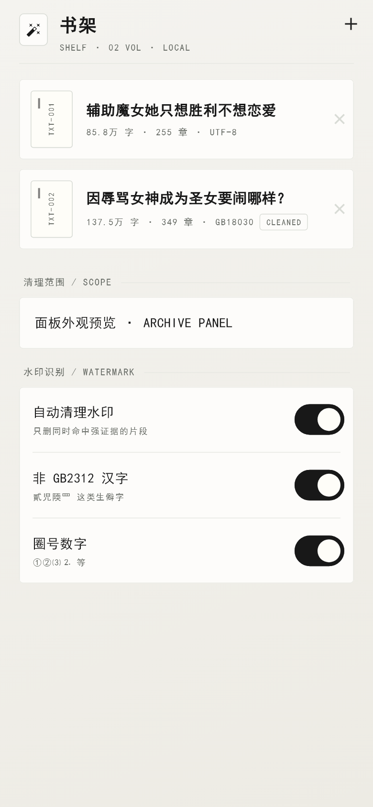
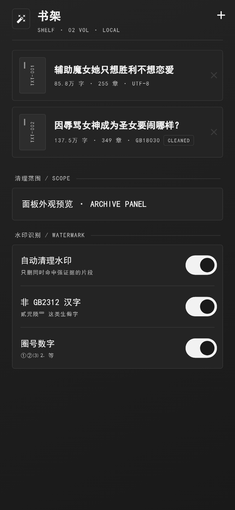

# 书籍清理 · BookCleaner

把 TXT 小说里被随机插入的「群号水印」、盗版站广告块、全角网址、被撑坏的章节标题清理干净的 Android 应用。

## 下载

- [`BookCleaner-v1.1.0.apk`](https://github.com/Z-Laboratory-1/book-cleaner/releases/latest/download/BookCleaner-v1.1.0.apk) — 17.3 MB，arm64，Android 7.0+（minSdk 24）

> 未做正式签名（debug 签名），安装时需允许「未知来源」，与商店版不能互相覆盖。

## 文档

- **[完整使用说明 → USAGE.md](USAGE.md)**：安装、每个开关的含义、复核候选怎么用、规则怎么扩充、常见问题

## 界面

书架（浅色 / 深色）：

 

## 功能

| 模块 | 说明 |
| --- | --- |
| 编码识别 | 自动按 UTF-8 / GB18030 / GBK / Big5 / UTF-16 解码，TXT 直接丢进来即可 |
| 广告与网址 | 整行盗版站广告（「中转群」「资源来源于网络」「请关注公众号…」）、全角网址 `ｗＷｗ.xx123.ｃｏＭ` |
| 章节结构 | 去掉标题前的 `?·` 垃圾前缀、修复被水印撑坏的章号、按标题重排、可选数字章号 |
| 水印识别 | 非 GB2312 汉字、怪符号（〆〩〡〽〾〣〦〤〞⊙〝〒）、圈号数字 ①②⑵、字母数字混排、数字同音字（貳氿玖叁肆…） |
| 复核候选 | 机器没把握的片段列出来，勾选后一键应用，只删不改 |
| 报告 | 逐章对比出报告，另出「待人工确认清单」（原站屏蔽词 `**`、被吞字的句子） |

## 快速上手

1. 书架右上角 **＋** 导入 TXT（自动识别编码）
2. 点进书 → 保持默认开关 → **开始清理**（85 万字约 1.7 秒）
3. 看「结果」面板的字数与「剩余非 GB」；有候选就进 **复核候选** 勾一遍
4. 右上角磁盘图标保存为 `<书名>_已清理.txt`
5. 阅读器不认章节时，再打开「章号转阿拉伯数字」+「按标题重排」保存一次

## 实测

- 《辅助魔女她只想胜利不想恋爱》85.9 万字：→ 85.7 万字，255 章校验一致
- 《因辱骂女神成为圣女要闹哪样？》139.2 万字（GB18030）：→ 137.5 万字，349 章
- 《不好好当反派，只能和黄毛贴贴！》101.1 万字（GB18030）：→ 100.0 万字，405 章

## 说明

清理规则全部外置在 `assets/rules.json`：广告关键词、保护词（掺和 / 蹦跶 / 嘚瑟 / 窸窣 / 涅槃…）、同音字表、怪符号表都可以直接加，不用改代码；App 内「规则」页也能改，存在 `rules_custom.json`。
